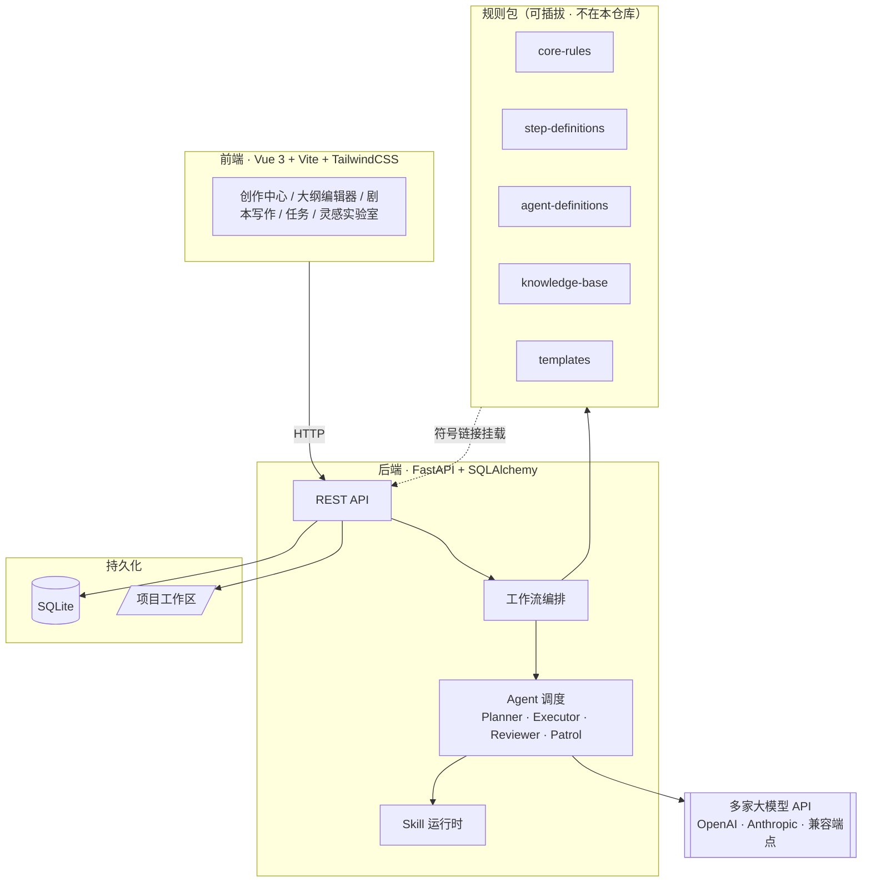

<div align="center">

# 墨戏生花 · Moxi

**以 AI 为墨，以戏为纸 —— 面向短剧剧本创作的开源 AI 工作流引擎**

把「灵感 → 大纲 → 人物 → 分集 → 分场 → 剧本 → 质检 → 合规 → 交付」整条创作链路，做成可编排、可回溯、可协作的工程化流水线。

[](LICENSE)
[](https://github.com/uluckyXH/OpenMOSS)
[](https://www.python.org/)
[](https://fastapi.tiangolo.com/)
[](https://vuejs.org/)
[](https://nodejs.org/)
[](CONTRIBUTING.md)

[核心特性](#-核心特性) · [架构](#-架构) · [快速开始](#-快速开始) · [接入自己的规则](#-接入自己的规则) · [贡献](#-贡献)

📚 深入阅读：[规则包规范](docs/rules-pack.md) · [部署指南](docs/deployment.md)

</div>

---

## 📖 这是什么

墨戏生花是一个**面向短剧剧本创作的开源 AI 工作流引擎**。

它不是一个「输入一句话、吐出一整部剧本」的黑盒生成器，而是一套**把长文本创作拆成可管理步骤**的工程系统：每一步都有明确的输入契约、可验证的产出、可回退的断点，以及 AI 与人类各自的贡献记录。

> ### 🙏 本项目基于 OpenMOSS 定制
>
> 墨戏生花的**多 Agent 协作内核**源自开源项目 **[OpenMOSS](https://github.com/uluckyXH/OpenMOSS)**（MIT License，作者：小黄、动动枪）。
> 我们在其之上实现了**短剧剧本创作**领域的工作流编排、领域模型与前端界面。
> 上游的版权与许可声明已完整保留于 [LICENSE](LICENSE)，谨此致谢。
>
> 如果你需要的是通用多 Agent 协作平台，请直接使用上游项目。

> **引擎开源，规则自持。**
> 本仓库提供完整的创作引擎（后端 / 前端 / 工作流编排）。
> 所有创作方法论 —— 写作规则、钩子库、爽感矩阵、题材配方 —— 均以**可插拔的规则包**形式接入，**不包含在本仓库内**。你可以接入自己的规则包，也可以从零开始构建。
>
> 详见 [接入自己的规则](#-接入自己的规则)。

## ✨ 核心特性

### 🧩 分段渐进写作

拒绝一次性生成整集。剧本按**场景（Scene）**为单位逐步推进：

- 每个场景独立保存断点，随时续作或回退
- 自动加载前文上下文，避免「失忆」
- 长剧本不再受单次模型上下文长度限制

### 🤝 人机贡献度追踪

清楚记录**谁写了什么**：

- **人工编辑** —— 编辑次数、增减字数
- **AI 生成** —— 生成内容、接受 / 修改 / 拒绝率
- **Skill 调用** —— 各技能使用频次
- **可视化** —— 饼图 / 热力图展示贡献分布

### 🔁 版本控制与 Diff

每个创作步骤都留痕，支持内容版本历史与差异对比，改坏了随时回溯。

### 🎛 多模型可切换

一个接口统一调度多家模型，按任务灵活分配：

| 类型 | 支持 |
|------|------|
| OpenAI 兼容 | OpenAI、DeepSeek、Kimi（月之暗面）、任意兼容端点 |
| Anthropic | Claude 系列 |

模型、密钥、限流均在配置中声明，无需改代码。

### 🤖 多 Agent 协作

内置经典的四角色工作流，各司其职：

| Agent | 职责 |
|-------|------|
| **Planner** | 规划师：拆解创作目标，生成任务 / 模块 / 子任务 |
| **Executor** | 执行者：领取任务并产出内容 |
| **Reviewer** | 评审员：审查产出质量，给出修改意见 |
| **Patrol** | 巡逻员：监控系统健康与任务流转 |

### 🛡 质量门与合规审查

- **多维度质检评分** —— 对生成内容做结构化评估
- **红线合规检测** —— 敏感内容识别与拦截
- **链路完整性校验** —— 确保上下集承接不丢失

> 评分与合规的**判定规则**同样来自可插拔规则包。

### 🔌 Skill 插件体系

创作能力以 Skill 形式扩展，引擎与具体领域知识解耦。

### 📚 RAG 知识库

支持接入外部知识库（含 Dify / DeFi 清单归档），让生成有据可依。

## 🏗 架构



**关键设计**：引擎通过 `01-system-core/prompts/` 这一「兼容入口」读取规则，其下 `rules` / `steps` / `agents` / `knowledge` / `templates` 均为**指向规则包的符号链接**。因此规则与引擎完全解耦 —— 替换规则包不需要改动任何代码。

## 🚀 快速开始

### 环境要求

| 组件 | 版本 |
|------|------|
| Python | 3.11+（推荐 3.12+） |
| Node.js | `^20.19.0` 或 `>=22.12.0` |
| 数据库 | SQLite（内置，无需额外安装） |

### 1. 克隆仓库

```bash
git clone https://github.com/w1251788888-web/moxi-drama-engine.git
cd moxi-drama-engine
```

### 2. 启动后端

```bash
cd 01-system-core

# 创建虚拟环境
python -m venv .venv
source .venv/bin/activate        # Windows: .venv\Scripts\activate

# 安装依赖
pip install -r requirements.txt

# 复制配置模板并填入你的 API Key
cp config.yaml.example config.yaml
cp .env.example .env             # 按需修改

# 启动
uvicorn app.main:app --reload --port 6565
```

后端启动后：

- 应用界面：http://127.0.0.1:6565
- API 文档（Swagger）：http://127.0.0.1:6565/docs

### 3. 启动前端（开发模式）

```bash
cd 01-system-core/webui
npm install
npm run dev
```

前端开发服务器默认运行在 http://127.0.0.1:5173 ，并代理后端接口。

### 4. 生产模式

```bash
cd 01-system-core/webui
npm run build
```

构建产物由后端统一托管，直接访问 http://127.0.0.1:6565 即可。

> 💡 仓库 `07-launch-tools/` 提供了 macOS 一键启动脚本（`start.command` / `dev-mode.command`），可双击运行。

## 🔌 接入自己的规则

这是本项目**最重要的设计**，也是「引擎开源、规则自持」的实现方式。

### 为什么规则要独立

短剧创作的核心竞争力在于**方法论**：怎样的开场抓人、钩子如何埋设、爽点怎么排布、不同受众偏好的节奏差异。这些是领域知识资产，而非通用工程代码。把它们与引擎耦合，会导致：

- 引擎无法被复用于其他题材 / 语种
- 方法论更新必须改动代码
- 无法按项目、按题材、按受众差异化配置

因此本项目将规则完全外置为**规则包（Rule Pack）**。

### 规则包结构

引擎期望在仓库根目录存在 `02-creation-rules/`，结构如下：

```
02-creation-rules/
├── core-rules/           # 核心写作规则（格式规范、写作逻辑、节奏控制…）
├── step-definitions/     # 各创作步骤定义（概念、人物、节拍表、分场…）
├── agent-definitions/    # 各 Agent 的角色提示词
├── knowledge-base/       # 领域知识（开场公式、爽感矩阵…）
└── templates/            # 提示词模板
```

引擎通过 `01-system-core/prompts/` 下的符号链接访问它们：

```
01-system-core/prompts/
├── rules     -> ../../02-creation-rules/core-rules
├── steps     -> ../../02-creation-rules/step-definitions
├── agents    -> ../../02-creation-rules/agent-definitions
├── knowledge -> ../../02-creation-rules/knowledge-base
└── templates -> ../../02-creation-rules/templates
```

### 两种用法

**方式 A：使用内置示例规则包**

仓库自带一份**通用示例规则包**（`02-creation-rules/`），足以跑通完整链路，用于体验引擎能力。它不是生产级方法论，请按需替换。

**方式 B：接入自己的规则包**

```bash
# 移除示例规则包
rm -rf 02-creation-rules

# 放入你的规则包（可来自私有仓库 / Git Submodule / 内网路径）
git submodule add <your-private-rules-repo> 02-creation-rules
```

只要目录结构与上述约定一致，引擎即可正常加载，**无需改动任何代码**。

> ⚠️ 建议将生产规则包放在**私有仓库**，以 `git submodule` 或部署时挂载的方式接入。

## 📁 项目结构

```
moxi-drama-engine/
├── 01-system-core/              # 系统核心：后端 + 前端
│   ├── app/                     # FastAPI 后端
│   │   ├── routers/             #   API 路由
│   │   ├── services/            #   业务服务（生成 / 规则解析 / RAG…）
│   │   ├── models/              #   SQLAlchemy 数据模型
│   │   └── main.py              #   应用入口
│   ├── webui/                   # Vue 3 前端
│   │   └── src/views/           #   页面视图
│   ├── prompts/                 # 规则兼容入口（符号链接 → 02-creation-rules）
│   ├── config.yaml.example      # 配置模板
│   ├── .env.example             # 环境变量模板
│   └── requirements.txt         # Python 依赖
│
├── 02-creation-rules/           # 规则包（示例版；生产规则请自持）
│
├── 07-launch-tools/             # 一键启动 / 停止脚本
│
├── docs/                        # 文档
│   ├── rules-pack.md            #   规则包规范
│   └── deployment.md            #   部署指南
│
├── CONTRIBUTING.md              # 贡献指南
└── LICENSE                      # MIT（含上游 OpenMOSS 版权声明）
```

## 🖥 界面一览

| 页面 | 路径 | 说明 |
|------|------|------|
| 创作中心 | `/create` | 集中式创作入口 |
| 大纲编辑器 | `/outline-editor` | 智能大纲分析与编辑 |
| 剧本写作 | `/script-writing/:projectId` | 场景级写作，实时角色关系联动 |
| 任务管理 | `/tasks` | 任务流转与状态跟踪 |
| 灵感实验室 | `/lab` | 热榜 / 推荐 / 内容解析 |
| 活动日志 | `/logs` | 系统与协作行为记录 |
| 账号设置 | `/settings` | 模型与账号配置 |

## 🔄 创作流程

```
项目初始化
    ↓
概念规划        Logline · 卖点 · 核心冲突
    ↓
角色设计        角色卡 · 声纹卡 · 关系张力
    ↓
分集节拍表      情绪曲线 · 爽感密度
    ↓
分场表          每集场次设计
    ↓
剧本初稿        场景级渐进写作（可断点续作）
    ↓
质检评分        多维度评估
    ↓
合规审查        红线检测
    ↓
导出交付        Word / txt
```

## 📡 API 速览

| 方法 | 路径 | 说明 |
|------|------|------|
| `POST` | `/api/v2/projects/` | 创建项目 |
| `GET` | `/api/v2/projects/` | 项目列表 |
| `POST` | `/api/v2/projects/{id}/episodes` | 创建分集 |
| `POST` | `/api/v2/projects/{id}/episodes/{n}/scenes/{m}/save` | 保存场景 |
| `GET` | `/api/v2/projects/{id}/contributions` | 贡献度统计 |

完整接口以运行后的 Swagger 文档（`/docs`）为准。

## 🗺 路线图

- [ ] 规则包热加载与版本管理
- [ ] 更丰富的模型供应商适配
- [ ] 协作编辑（多人同时在线）
- [ ] 导出格式扩展（Final Draft / Fountain）
- [ ] 完整英文文档

## 🤝 贡献

欢迎任何形式的参与 —— 提 Issue、修 Bug、补文档、加功能。

请先阅读 [CONTRIBUTING.md](CONTRIBUTING.md)。核心约定：

- 提交前跑通测试：`cd 01-system-core && pytest`
- 前端改动请确保 `npm run type-check` 与 `npm run lint` 通过
- **请勿在本仓库提交任何私有规则包内容或真实 API 密钥**

## 🙏 致谢

本项目站在巨人的肩膀上：

| 项目 | 说明 |
|------|------|
| **[OpenMOSS](https://github.com/uluckyXH/OpenMOSS)** | 多 Agent 协作内核。作者：小黄、动动枪。MIT License。墨戏生花的任务编排、Agent 调度与后台管理架构均构建于此 |
| [OpenClaw](https://github.com/openclaw/openclaw) | Agent 运行与唤醒机制 |
| [FastAPI](https://fastapi.tiangolo.com/) · [Vue 3](https://vuejs.org/) · [Vite](https://vitejs.dev/) · [TailwindCSS](https://tailwindcss.com/) | 技术栈基石 |

墨戏生花的增量贡献在于：短剧领域工作流、场景级渐进写作、人机贡献度追踪、
质量门与合规链路、以及可插拔规则包机制。

## 📄 License

本项目采用 **[MIT License](LICENSE)**，与上游 OpenMOSS 保持一致。

```
Copyright (c) 2026 小黄, 动动枪 — OpenMOSS
Copyright (c) 2026 墨戏生花 (Moxi) contributors
```

**请注意**：由于本项目是 OpenMOSS 的衍生作品，上游的版权声明与 MIT 许可原文
已完整保留（见 [LICENSE](LICENSE)）。任何再分发都必须同样保留这两项声明。

规则包（`02-creation-rules/`）如由你自行提供，其授权条款由你自行决定。

---

<div align="center">

**墨戏生花** —— 让 AI 辅助剧本创作，而创作的灵魂永远在人。

</div>
